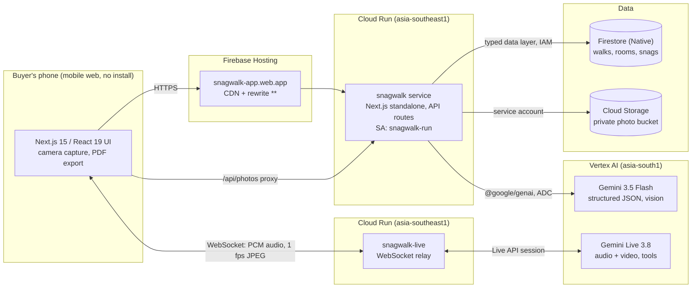

# SnagWalk architecture

## System



Build and release: Cloud Build (Dockerfile, multi-stage) pushes to Artifact Registry, `gcloud run deploy`
rolls a new revision, and `pnpm release:hosting` re-releases Firebase Hosting so the CDN drops cached pages.

## Request flows

### Photograph a defect

1. The phone compresses the photo (max edge 1800 px) and posts it to `POST /api/rooms/[roomId]/snags`
   (type and size validated: JPEG, PNG, WebP or HEIC, 12 MB max).
2. The route uploads to Cloud Storage and calls Gemini **in parallel**, so analysis does not wait on the upload.
3. Gemini returns `{category, severity, description, location_note, box_2d}` under a `responseSchema` with enum
   constraints. `normalizeSnagAnalysis` still coerces anything off-enum and drops invalid boxes. The snag row
   is inserted with these values.
4. The UI draws `box_2d` on the photo and shows the fields for review. The buyer corrects them
   (`PUT /api/snags/[snagId]`, validated against the enums) or discards the snag (`DELETE`).

### Inspect live (Gemini Live)

1. The page opens a WebSocket to the `snagwalk-live` relay (URL from `GET /api/live/config`; the feature hides when
   unset). The relay checks the Origin header, caps sessions at 5 minutes and opens a Gemini Live session on Vertex
   with a room-specific system prompt and one tool, `log_snag(description, category, severity)`.
2. The browser streams mic audio (AudioWorklet, resampled to 16 kHz PCM16, 100 ms chunks) and one 640 px JPEG frame
   per second, and plays Gemini's 24 kHz speech. The mic is gated while Gemini talks so a phone speaker cannot
   interrupt it; quick-question chips cover noisy rooms.
3. On `log_snag` the relay answers the tool call at once and tells the browser, which captures a sharp 1600 px frame
   and posts it, with Gemini Live's one-line note, to the normal `POST /api/rooms/[roomId]/snags`. The relay never
   touches the database, so live snags get the same storage, validation, classification and bounding box.

### Write the builder letter

1. `GET /api/walks/[walkId]/letter` loads the saved letter and compares its fingerprint (SHA-256 of the walk and
   every snag) with the current snags. Any add, edit or delete makes it stale.
2. A stale or missing letter triggers `POST`, which sends Gemini only the recorded snags, numbered to match the
   photo annexure, plus fixed rules: group by room, cite every photo exactly once, 15-day deadline, RERA
   Section 14(3) clause, chosen language (English, Hindi, Marathi), no invented facts.
3. The Markdown is stored with a trailing marker (`<!-- snagwalk:fp=...;src=...;lang=... -->`), never shown to the user.
4. The browser renders the letter on an A4-width "paper" and exports a PDF with block-aware page breaks
   (`src/lib/pdf-breaks.ts`), so no paragraph or photo row is cut in half.

## Design decisions

| Decision | Why |
| --- | --- |
| Gemini 3.5 Flash in `asia-south1`, low thinking, medium media resolution | Measured ~4.6 s per photo, steady across runs. Gemini 3.8 Flash and Gemini 4 models are served only from `global` here and were slower (8-21 s) in the same test. The buyer is standing in the flat, so latency wins. |
| Structured output + server-side normalisation | Schema constraints make Gemini reliable; normalisation makes the database and UI safe even when it is not. |
| Letter grounded only in the snags table, fingerprinted | A legal-style notice must not cite a defect that does not exist or was deleted. Staleness is detected, not guessed. |
| Firestore instead of a SQL database | Serverless and inside the free tier at this scale, no instances to keep running, no passwords (the service account authenticates through IAM). The project first ran on AlloyDB Express, reached through a hand-written Node.js connector; when event billing lapsed the Express instance was removed permanently, while Firestore data survives a lapse. All access goes through one typed interface (`src/lib/store.ts`) with a Firestore backend and a local JSON backend, so the switch touched no UI code. |
| Private bucket + same-origin photo proxy | Photos are personal. The proxy also keeps the PDF canvas untainted for export. |
| Honest fallbacks | Every AI result carries `source: 'gemini' \| 'fallback'`; the UI labels fallbacks. Production disables the local DB and storage fallbacks so failures are visible, not silent. |
| Process-wide state on `globalThis` | Next.js loads library modules per route bundle; the pool, circuit breaker and AI status must be shared. |
| Guardrails as an Agent Skill | `.agents/skills/snagwalk-guardrails/SKILL.md` holds the database, Gemini and letter rules that both the coding agent and the code follow. The typed data layer and output normalisation enforce them at runtime and are unit tested. |

## Data model (Firestore)

```
walks/{uuid}  buyer_name, builder_name, project_name, tower, flat_number, bhk, possession_date,
              letter_text, created_at
rooms/{uuid}  walk_id, room_type, status, checklist[], created_at
snags/{uuid}  walk_id, room_id, category, severity (minor|major|critical), description,
              location_note, photo_url, created_at
```

Top-level collections keyed by uuid; route params are uuid-validated before any read. A walk and its rooms
are written in one atomic batch. List queries filter on a single field and sort in memory, so no composite
indexes are needed. Photos live in Cloud Storage; only the URL is stored. The data layer exposes
single-document deletes only.

## Scaling

- Cloud Run scales from zero to `--max-instances` on request concurrency; the app is stateless apart from the
  database and bucket.
- Firestore scales automatically with no capacity planning; reads per screen are bounded (one walk, its rooms,
  its snags), and the free tier (50k reads, 20k writes per day) covers hundreds of inspections a day.
- Gemini calls are per user action (one per checklist, photo or letter). Measured cost of a real two-room run:
  6 calls, about $0.05. A full 3 BHK inspection is roughly $0.25 of AI cost.

## Testing

| Layer | What | Command |
| --- | --- | --- |
| Unit (Vitest, 142 tests) | inspection-practice checklists, design-token WCAG AA contrast (both themes), page breaks, Gemini output normalisation, fallback letter invariants, letter fingerprint and marker, data layer contract, photo numbering, room provisioning, formatting | `pnpm test` |
| End to end (19 checks) | walk, rooms, checklist, photo analysis, photo proxy, edit validation, letter, stale detection, delete, against a running server with real Gemini, Firestore and Cloud Storage | `pnpm smoke <url> <photo.jpg>` |
| CI | typecheck, lint, unit tests, build on every push | `.github/workflows/ci.yml` |
