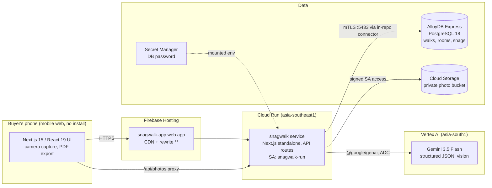

# SnagWalk architecture

## System



Build and release: Cloud Build (Dockerfile, multi-stage) pushes to Artifact Registry, `gcloud run deploy`
rolls a new revision, and `pnpm release:hosting` re-releases Firebase Hosting so the CDN drops cached pages.

## Request flows

### Photograph a defect

1. The phone compresses the photo (max edge 1800 px) and posts it to `POST /api/rooms/[roomId]/snags`
   (type and size validated: JPEG, PNG, WebP or HEIC, 12 MB max).
2. The route uploads to Cloud Storage and calls Gemini **in parallel**, so analysis does not wait on the upload.
3. Gemini returns `{category, severity, description, location_note, box_2d}` under a `responseSchema` with enum
   constraints. `normalizeSnagAnalysis` still coerces anything off-enum and drops invalid boxes. The snag row
   is inserted with these values.
4. The UI draws `box_2d` on the photo and shows the fields for review. The buyer corrects them
   (`PUT /api/snags/[snagId]`, validated against the enums) or discards the snag (`DELETE`).

### Write the builder letter

1. `GET /api/walks/[walkId]/letter` loads the saved letter and compares its fingerprint (SHA-256 of the walk and
   every snag) with the current snags. Any add, edit or delete makes it stale.
2. A stale or missing letter triggers `POST`, which sends Gemini only the recorded snags, numbered to match the
   photo annexure, plus fixed rules: group by room, cite every photo exactly once, 15-day deadline, RERA
   Section 14(3) clause, chosen language (English, Hindi, Marathi), no invented facts.
3. The Markdown is stored with a trailing marker (`<!-- snagwalk:fp=...;src=...;lang=... -->`), never shown to the user.
4. The browser renders the letter on an A4-width "paper" and exports a PDF with block-aware page breaks
   (`src/lib/pdf-breaks.ts`), so no paragraph or photo row is cut in half.

## Design decisions

| Decision | Why |
| --- | --- |
| Gemini 3.5 Flash in `asia-south1`, low thinking, medium media resolution | Measured ~4.6 s per photo, steady across runs. Gemini 3.8 Flash and Gemini 4 models are served only from `global` here and were slower (8-21 s) in the same test. The buyer is standing in the flat, so latency wins. |
| Structured output + server-side normalisation | Schema constraints make Gemini reliable; normalisation makes the database and UI safe even when it is not. |
| Letter grounded only in the snags table, fingerprinted | A legal-style notice must not cite a defect that does not exist or was deleted. Staleness is detected, not guessed. |
| Hand-written AlloyDB connector (`src/lib/alloydb-connector.ts`) | No Node.js AlloyDB connector exists on npm. The module implements the Auth Proxy protocol (Admin API client certificate, mutual TLS on 5433, metadata exchange), so the app reaches AlloyDB Express from Cloud Run or a laptop with IAM and no VPC connector. |
| Private bucket + same-origin photo proxy | Photos are personal. The proxy also keeps the PDF canvas untainted for export. |
| Honest fallbacks | Every AI result carries `source: 'gemini' \| 'fallback'`; the UI labels fallbacks. Production disables the local DB and storage fallbacks so failures are visible, not silent. |
| Process-wide state on `globalThis` | Next.js loads library modules per route bundle; the pool, circuit breaker and AI status must be shared. |
| Guardrails as an Agent Skill | `.agents/skills/snagwalk-guardrails/SKILL.md` holds the database, Gemini and letter rules that both the coding agent and the code follow. The SQL guard and output normalisation enforce them at runtime and are unit tested. |

## Data model (AlloyDB)

```
walks  (id uuid pk, buyer_name, builder_name, project_name, tower, flat_number, bhk smallint,
        possession_date date, letter_text, created_at)
rooms  (id uuid pk, walk_id -> walks ON DELETE CASCADE, room_type, checklist jsonb, status, created_at)
snags  (id uuid pk, walk_id -> walks, room_id -> rooms ON DELETE CASCADE, photo_url, category,
        severity CHECK (minor|major|critical), description, location_note, created_at)
```

Photos live in Cloud Storage; only the URL is stored. All SQL is parameterized; `DROP` and `TRUNCATE` are
rejected before any query runs.

## Scaling

- Cloud Run scales from zero to `--max-instances` on request concurrency; the app is stateless apart from the
  database and bucket.
- AlloyDB connections are pooled (max 5 per instance); the connector caches its client certificate and
  refreshes it 5 minutes before expiry.
- Gemini calls are per user action (one per checklist, photo or letter). Measured cost of a real two-room run:
  6 calls, about $0.05. A full 3 BHK inspection is roughly $0.25 of AI cost.

## Testing

| Layer | What | Command |
| --- | --- | --- |
| Unit (Vitest, 64 tests) | page breaks, SQL guard, Gemini output normalisation, fallback letter invariants, letter fingerprint and marker, connector protobuf, room provisioning, formatting | `pnpm test` |
| End to end (19 checks) | walk, rooms, checklist, photo analysis, photo proxy, edit validation, letter, stale detection, delete, against a running server with real Gemini, AlloyDB and Cloud Storage | `pnpm smoke <url> <photo.jpg>` |
| CI | typecheck, lint, unit tests, build on every push | `.github/workflows/ci.yml` |
